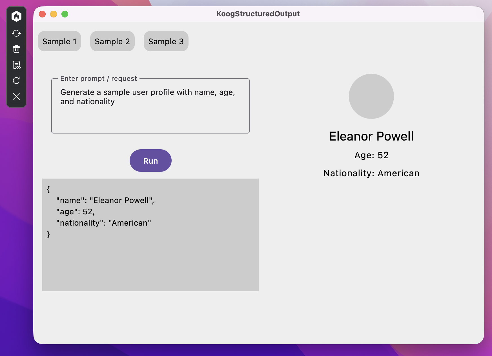

# KoogStructuredOutput

A **Kotlin Multiplatform (KMP)** project targeting **Android**, **iOS**, and **Desktop (JVM)** demonstrating structured output generation from Large Language Models (LLMs) using the **[Koog AI Agents Framework](https://github.com/koog-ai)**.

The application prompts a locally running **Ollama** model (`llama3.2`) to generate realistic fictional user profiles. Using Koog's structured output node and schema annotations, the AI responses are guaranteed to conform to strongly-typed Kotlin data classes, which are automatically parsed and displayed in a shared **Compose Multiplatform** UI.




---

## 🚀 Features

- **Cross-Platform UI**: Single codebase UI powered by Compose Multiplatform across Android, Desktop, and iOS.
- **Structured LLM Output**: Uses `@LLMDescription` and `@Serializable` annotations to guide the LLM's output directly into Kotlin data structures.
- **Few-Shot Prompt Guidance**: Passes example data instances to the LLM for high reliability and structured output accuracy.
- **Koog Agent Strategy**: Configures agent execution flows via graph DSL (`strategy`, `nodeLLMRequestStructured`, `node`, `edge`).
- **Platform-Specific Ollama Integration**: Uses target-specific Ollama host configurations (`http://10.0.2.2:11434` on Android Emulator, `http://localhost:11434` on Desktop JVM, custom local IP for iOS).

---

## 🛠 Project Structure

```
KoogStructuredOutput/
├── androidApp/         # Android application entry point (MainActivity)
├── desktopApp/         # Desktop JVM application entry point (main.kt)
├── iosApp/             # Xcode iOS project wrapping shared Compose UI
├── shared/             # Multiplatform shared logic module
│   └── src/
│       ├── commonMain/ # Shared UI, Koog Agent DSL, models, and platform abstractions
│       ├── androidMain/# Android-specific Platform implementation & Ollama URL mapping
│       ├── jvmMain/    # Desktop JVM-specific Platform implementation & Ollama URL mapping
│       └── iosMain/    # iOS-specific Platform implementation & Ollama URL mapping
└── gradle/
    └── libs.versions.toml # Centralized Gradle version catalog
```

---

## ⚙️ Library & Build Configuration

The project uses Gradle Version Catalog (`gradle/libs.versions.toml`) to manage dependencies across targets.

### `libs.versions.toml` Excerpt

```toml
[versions]
kotlin = "2.4.21"
agp = "9.1.1"
composeMultiplatform = "1.12.2"
material3 = "1.12.0-alpha03"
androidx-lifecycle = "2.11.0"
koogAgents = "1.2.0"
koogAgentsAdditions = "1.0.0-beta"

[libraries]
# Koog AI Agent Framework
koog-agents = { module = "ai.koog:koog-agents", version.ref = "koogAgents" }
koog-agents-additions = { module = "ai.koog:koog-agents-additions", version.ref = "koogAgentsAdditions" }

# Compose Multiplatform & Lifecycle
compose-runtime = { module = "org.jetbrains.compose.runtime:runtime", version.ref = "composeMultiplatform" }
compose-foundation = { module = "org.jetbrains.compose.foundation:foundation", version.ref = "composeMultiplatform" }
compose-material3 = { module = "org.jetbrains.compose.material3:material3", version.ref = "material3" }
androidx-lifecycle-viewmodelCompose = { module = "org.jetbrains.androidx.lifecycle:lifecycle-viewmodel-compose", version.ref = "androidx-lifecycle" }
```

### Shared Module (`shared/build.gradle.kts`)

```kotlin
plugins {
    alias(libs.plugins.kotlinMultiplatform)
    alias(libs.plugins.androidMultiplatformLibrary)
    alias(libs.plugins.composeMultiplatform)
    alias(libs.plugins.composeCompiler)
    alias(libs.plugins.kotlinxSerialization)
}

kotlin {
    listOf(iosArm64(), iosSimulatorArm64()).forEach { iosTarget ->
        iosTarget.binaries.framework {
            baseName = "Shared"
            isStatic = true
        }
    }
    jvm()
    android {
        namespace = "dev.ell.koogstructuredoutput.shared"
        compileSdk = 37
        minSdk = 26
    }
    sourceSets {
        commonMain.dependencies {
            implementation(libs.compose.runtime)
            implementation(libs.compose.foundation)
            implementation(libs.compose.material3)
            implementation(libs.koog.agents)
            implementation(libs.koog.agents.additions)
        }
    }
}
```

---

## 💡 Code Implementation & Key Examples

### 1. Defining the Structured Response Data Class

`@LLMDescription` provides metadata that Koog injects into the prompt structure to instruct the LLM on field expectations.

```kotlin
@Serializable
@SerialName("UserDetailsResponse")
@LLMDescription("A fictional user's profile information")
data class UserDetailsResponse(
    @property:LLMDescription("Full name of the user")
    val name: String,

    @property:LLMDescription("Age of the user as an integer")
    val age: Int,

    @property:LLMDescription("Nationality of the user")
    val nationality: String,
)
```

### 2. Providing Few-Shot Examples

Providing sample instances improves model compliance with structured format output:

```kotlin
val exampleUserDetails = listOf(
    UserDetailsResponse(name = "Alice Johnson", age = 25, nationality = "American"),
    UserDetailsResponse(name = "David Smith", age = 30, nationality = "Canadian"),
    UserDetailsResponse(name = "James Wilson", age = 22, nationality = "British"),
)
```

### 3. Agent & Strategy Implementation (`AgentProvider.kt`)

Koog Agents use a strategy flow constructed with graph nodes:

```kotlin
class AgentProvider {

    fun provideAgent(): AIAgent<String, String> {
        val platform = getPlatform()

        val agentStrategy = strategy<String, String>("mock-user-details") {
            // Node requesting structured response matching UserDetailsResponse schema
            val generateUserDetails by nodeLLMRequestStructured<UserDetailsResponse>(
                name = "generate-user-details",
                examples = exampleUserDetails,
            )

            // Node processing and converting structured result to formatted JSON
            val processUserDetails by node<Result<StructuredResponse<UserDetailsResponse>>, String> { result ->
                val userDetails = result.getOrThrow().data
                jsonFormatter.encodeToString(UserDetailsResponse.serializer(), userDetails)
            }

            edge(nodeStart forwardTo generateUserDetails)
            edge(generateUserDetails forwardTo processUserDetails)
            edge(processUserDetails forwardTo nodeFinish)
        }

        val agentConfig = AIAgentConfig(
            prompt = prompt("mock-user-prompt") {
                system(
                    """
                    You are an intelligent Mock User Profile Generator.
                    Follow these rules:
                    1. Generate fictional user information only.
                    2. Always generate a realistic full name.
                    3. The user's age must be between 18 and 80.
                    4. Age must always be an integer.
                    5. Nationality must be a valid nationality.
                    """.trimIndent()
                )
            },
            model = platform.llmModel,
            maxAgentIterations = 5,
        )

        return AIAgent(
            promptExecutor = platform.promptExecutor,
            toolRegistry = ToolRegistry.EMPTY,
            strategy = agentStrategy,
            agentConfig = agentConfig,
        )
    }
}
```

### 4. Platform-Specific LLM Configuration (`Platform`)

An `expect`/`actual` interface maps target platforms to their corresponding Ollama host addresses:

```kotlin
interface Platform {
    val name: String
    val llmModel: LLModel
    val promptExecutor: PromptExecutor
}

// Android (Platform.android.kt): Android Emulator uses 10.0.2.2 for host loopback
class AndroidPlatform : Platform {
    override val name: String = "Android ${Build.VERSION.SDK_INT}"
    override val llmModel: LLModel = OllamaModels.Meta.LLAMA_3_2
    override val promptExecutor: PromptExecutor = simpleOllamaAIExecutor(
        "http://10.0.2.2:11434",
        httpClientFactory = KtorKoogHttpClient.Factory()
    )
}

// Desktop (Platform.jvm.kt): Uses local host directly
class JVMPlatform : Platform {
    override val name: String = "Java ${System.getProperty("java.version")}"
    override val llmModel: LLModel = OllamaModels.Meta.LLAMA_3_2_3B
    override val promptExecutor: PromptExecutor = simpleOllamaAIExecutor("http://localhost:11434")
}
```

### 5. Shared UI Integration (`StructuredOutputUI.kt`)

The Compose UI triggers the agent asynchronously and parses the resulting structured JSON into `UserDetailsResponse`:

```kotlin
@Composable
fun StructuredOutputUI() {
    var text by remember { mutableStateOf("") }
    var displayText by remember { mutableStateOf("") }
    var user by remember { mutableStateOf(UserDetailsResponse("", 0, "")) }
    var isLoading by remember { mutableStateOf(false) }
    val coroutineScope = rememberCoroutineScope()

    val onRunClick = {
        if (text.isNotBlank() && !isLoading) {
            coroutineScope.launch {
                isLoading = true
                try {
                    val agent = AgentProvider().provideAgent()
                    val responseJson = agent.run(text)
                    displayText = responseJson
                    // Directly decode JSON into UserDetailsResponse and update UI profile state
                    user = Json.decodeFromString<UserDetailsResponse>(responseJson)
                } catch (e: Exception) {
                    displayText = "Error running agent: ${e.message}"
                } finally {
                    isLoading = false
                }
            }
        }
    }
    
    // UI Layout Rendering InputField & UserProfile view...
}
```

---

## 🏃 Prerequisites & Running the Application

### Prerequisites

1. Install and run [Ollama](https://ollama.com/).
2. Pull the required model:
   ```bash
   ollama run llama3.2
   ```

### Running Applications

- **Android App**: `./gradlew :androidApp:assembleDebug` or run from Android Studio.
- **Desktop App**:
  - Hot reload: `./gradlew :desktopApp:hotRun --auto`
  - Standard run: `./gradlew :desktopApp:run`
- **iOS App**: Open `/iosApp` directory in Xcode and build/run on Simulator or Device.

### Running Tests

- Android tests: `./gradlew :shared:testAndroidHostTest`
- Desktop tests: `./gradlew :shared:jvmTest`
- iOS tests: `./gradlew :shared:iosSimulatorArm64Test`
